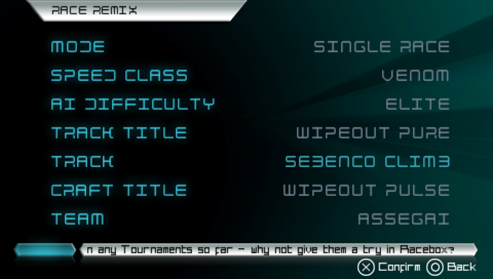
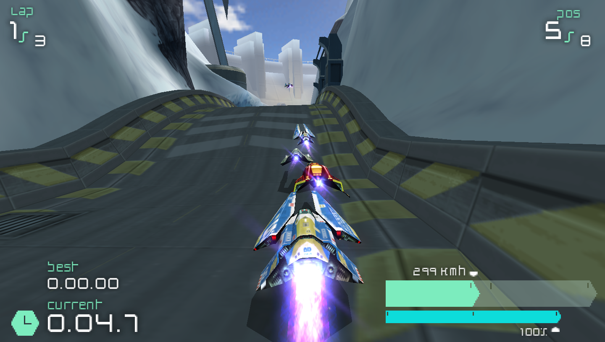
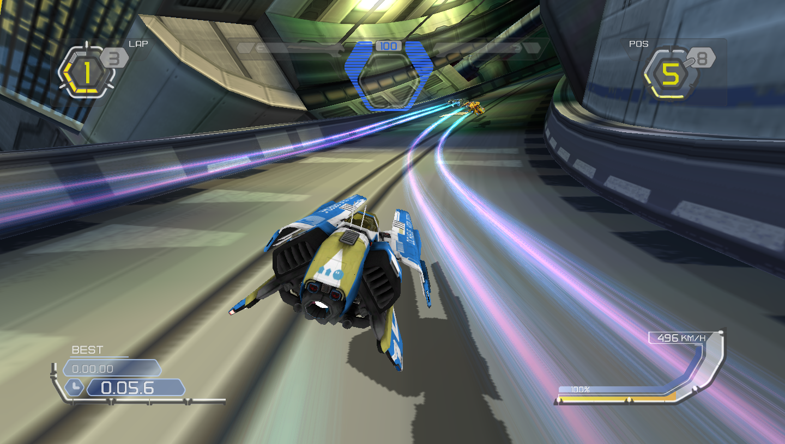

# RACE REMIX (`oag.remix`)

RACE REMIX races one title's track with another title's craft. Pick a Wipeout Pure
circuit and fly a Wipeout Pulse ship on it, or take a Wipeout HD craft round a Pulse
circuit. It uses the disc images you already own: it adds no game content of its own.

## What you get

- A **REMIX** row on the main menu, next to RACEBOX. On Wipeout 2048's tile grid it is a
  REMIX tile.
- A **RACE REMIX** page with its own settings. They are saved separately from the RACE
  page, so remixing never changes your normal race setup.
- A race that loads the track from one disc and the craft from another.

Turn the mod off on the MODS page and the row, the page and the tile are gone. Nothing
else in the game changes. RACE REMIX does not change how a race plays, so it does not
count against the LAN fingerprint.

## How to use it

1. Open **REMIX** from the main menu.
2. Set **MODE**, **SPEED CLASS** and **AI DIFFICULTY**. The speed class list is every
   class any of your titles has. AI DIFFICULTY is greyed in modes that have no
   opponents, and a class that no driver covers races without opponents.
3. Choose **TRACK TITLE**, then **TRACK**. The track list is that title's circuits.
   `CUSTOM` appears when the game finds a custom track file on your machine.
4. Choose **CRAFT TITLE**, then **TEAM** and **VARIANT**. The team list only shows teams
   that have a craft in the speed class you picked.
5. Choose **START**.

A title only appears in the lists when its disc image is on the game's search path
(`data/images/` in a checkout). With one disc, both title rows offer that one title and
the page is an ordinary custom race.

## Examples

A Wipeout Pulse craft on a Wipeout Pure track, a few seconds after GO (Sebenco Climb,
Assegai, single race):

A Wipeout HD craft on a Wipeout Pulse track, a few seconds after GO (Talon's Junction
White, single race). The craft brings HD's HUD with it:

## About the screenshots

The three images are frames of this engine running its owner's own copies of the games,
shown as illustration. They are credited to their rights holders: Wipeout and related names
belong to their owners, and the project is not affiliated with or endorsed by Sony
Interactive Entertainment or Studio Liverpool. They can be removed on request (see the
engine repository's `docs/overview/legal.md`). The mod itself contains no game content.

## Files

- `oag-mod.toml`: the mod manifest.
- `menu.toml`: the REMIX row and the page.
- `strings/`: the text of the page's own rows, in each language.

The format is documented in the engine repository (`docs/tools/mods.md`).
