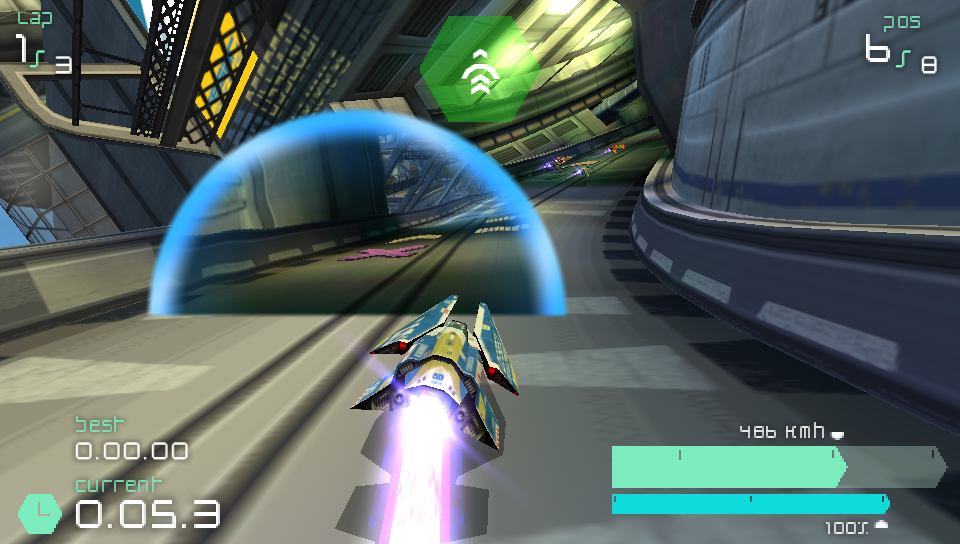
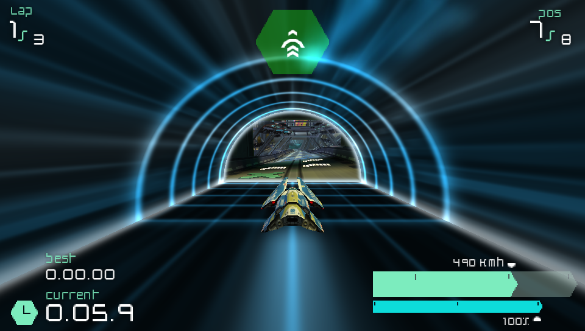
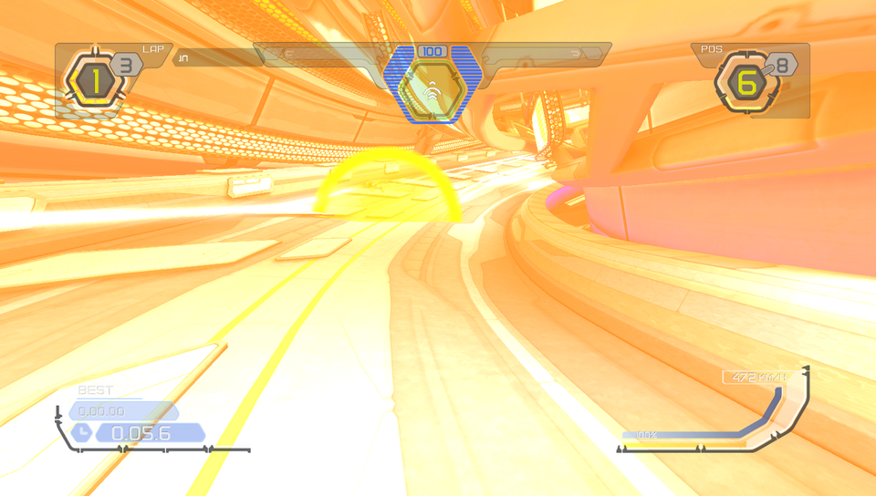

# Slipstream (`oag.slipstream`)

A pickup of its own, handed out by the weapon pads beside the title's weapons. Fire it and
the craft goes through a portal and comes out about two seconds further along the circuit,
a little slower. It adds no game content: the icons are original art (`icons/README.md`) and
the portal is a tinted half disc (`fx/portal.png`) and the sounds are synthesised by
`src/synth_sounds.py`.

Off until you turn it on on the MODS page. It supports Wipeout Pulse (PSP and PS2 share one
icon), Wipeout Pure, HD/Fury, Omega and 2048.

## How it plays

- **Pick it up** on a weapon pad. Its share of the draws is its own `[[pickup.odds]]` row
  (the same for every title and class), not a swap of another weapon.
- **Fire it** (the pickup button) when the road ahead has room: the portal is a half disc
  12 units across the road's middle, 30 units in front of the craft, and it must fit (the
  road at least 24 wide, nothing between its middle and its rim). With no room the press
  is dropped and you keep the pickup. The AI fires it where the engine's Turbo gate would,
  with the same room rule.
- **Transit** lasts one second: the craft is out of the world (not drawn, not collided with,
  not hit or locked, no steering, no thrust). Your view fills with the title's portal colour
  and the field of view widens by 20 degrees for the whole second.
- **Exit** two seconds of your speed further along the circuit at 90 % of your speed. Laps and
  the finish count through the jump: a jump over the line is a lap, or the finish, on the exit
  tick.
- **One portal at a time.** A fire while another craft is in transit waits in a queue and
  runs when that transit ends, if the portal still fits then.

- **The portal's surface** shows the road at the exit (`fx/portal.wgsl`). OPTIONS > SLIPSTREAM > PORTAL VIEW: Low is an animated
  surface with no second view, Medium one snapshot per portal, High the view every frame (default). It changes nothing in the race.

- **Sound.** Entering plays a short rising whoosh (`portal-open`) and a low hum
  (`transit`) that lasts the transit; coming out ends the hum and plays a softer falling
  whoosh (`portal-exit`). They come from the craft: you hear your own dry and a rival's
  placed in the world. These are placeholders we synthesise ourselves: `src/synth_sounds.py`
  writes `sounds/*.wav` (standard library only, seeded, MIT OR Apache-2.0), peaks between
  -6 and -11 dBFS. Real sounds replace the three files under the same names.

## Tuning

Every number is in `guest/src/lib.rs` (distance, radius, transit ticks, exit factor, field of
view, fill ramp) and is **chosen, not measured**; the odds are in `oag-mod.toml`. The portal
look is `Look::of` and `fx/`: a later engine piece draws a real portal, and only those two
change then.

Rebuild after changing the guest: `guest/build.sh` (needs `rustup target add
wasm32-unknown-unknown`), and commit `ext/slipstream.wasm`. `cargo test` in `guest/` runs the
rules natively.
